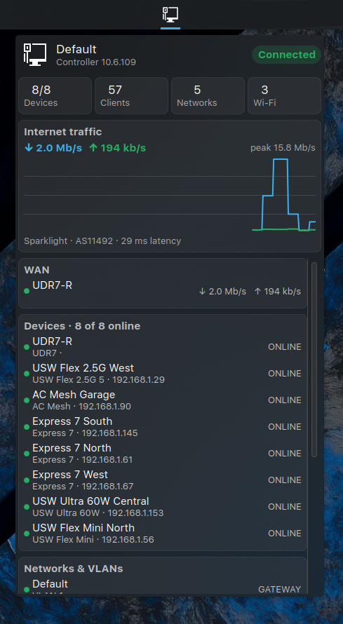

# unifistatus
unifi console status monitor plasmoid



## Translations

The widget uses KDE's `i18n()` functions and gettext PO catalogs. Plasma assigns
the domain `plasma_applet_com.democe.unifistatus` from the widget ID for both
the popup and settings. Untranslated messages fall back to English.

Install GNU gettext tools, then regenerate the template after changing QML:

```sh
sh Messages.sh
```

Create a translation with `msginit --input=po/plasma_applet_com.democe.unifistatus.pot --locale=fr --output-file=po/fr.po`,
or update an existing one with
`msgmerge --update po/fr.po po/plasma_applet_com.democe.unifistatus.pot`.
Replace `fr` with the gettext language code and translate the `msgstr` entries.
Keep placeholders such as `%1` and `%2`; translators may reorder them. Use
`i18nc`, `i18np`, or `i18ncp` for context or plurals when needed, and add
`// TRANSLATORS:` comments for ambiguous strings.

Compile and install a catalog for the current user:

```sh
domain=plasma_applet_com.democe.unifistatus
locale_dir="${XDG_DATA_HOME:-$HOME/.local/share}/locale/fr/LC_MESSAGES"
mkdir -p "$locale_dir"
msgfmt --check -o "$locale_dir/$domain.mo" po/fr.po
```

Restart Plasma or reload the widget to pick up catalog changes. The PO files
cover QML messages, not the widget-list name and description in
`metadata.json`, which KDE localizes separately using `Name[fr]` and
`Description[fr]` entries. The configuration XML labels are schema metadata;
the visible settings labels are translated in QML. Names and status values
returned by the UniFi console are not part of the catalog.
